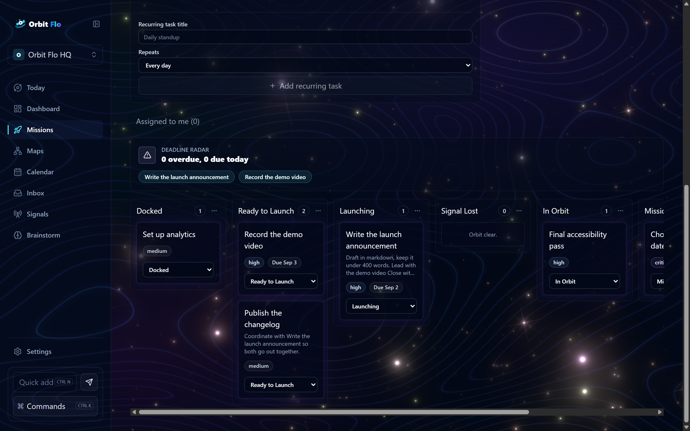
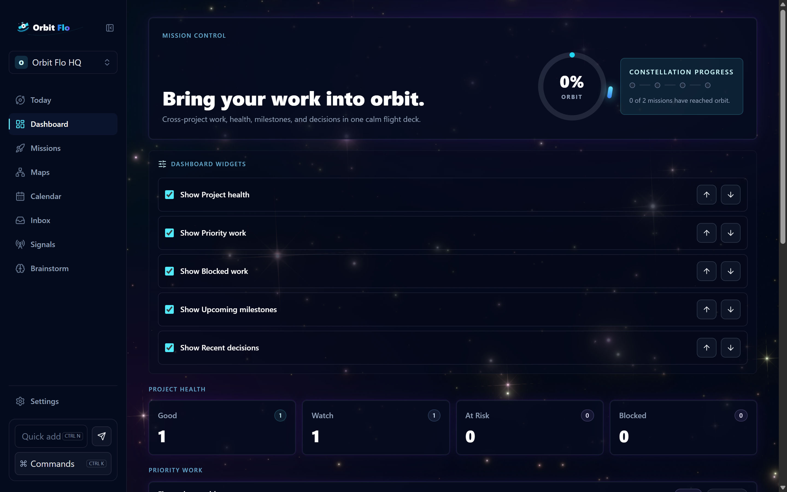
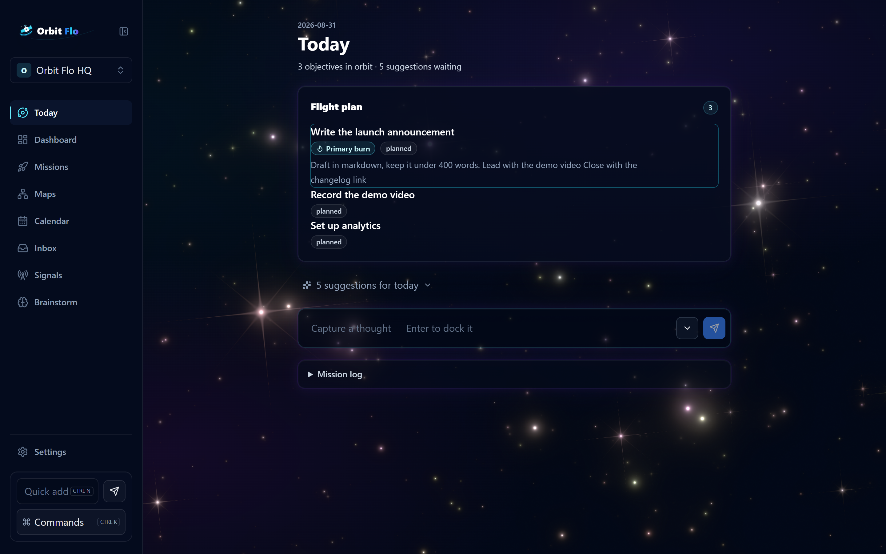
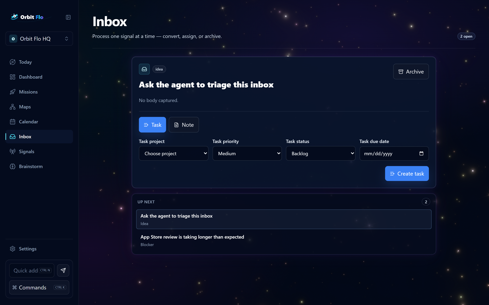
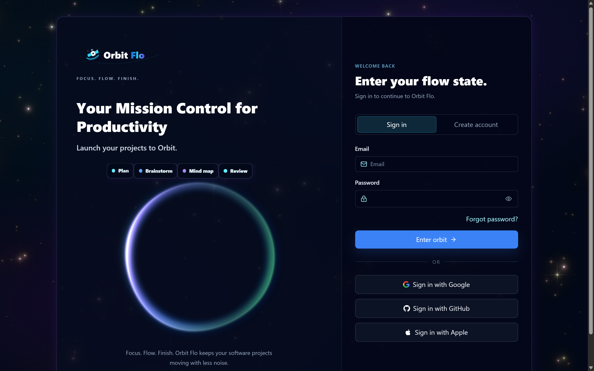

# Orbit Flo

**A deep-space project workspace you share with your agent.**

[](https://github.com/PhilPNG/orbit-flo/actions/workflows/ci.yml)
[](LICENSE)
[](#webmcp-an-agent-can-work-this-app)

Orbit Flo takes personal software projects from idea to done — kanban boards,
daily flight plans, milestones, linked notes, and an inbox for stray thoughts —
rendered as a live WebGL galaxy you work inside. And through
[WebMCP](https://github.com/webmachinelearning/webmcp), a browser-hosted agent
can operate the same workspace through your own signed-in session, its work
landing on your board as it talks.



## A tour

### Mission control

Cross-project health, priority work, upcoming milestones, and recent decisions
on one dashboard. The numbers tick up as they load; the constellation tracks
missions that have reached orbit.



### Today's flight plan

Each day gets a plan: a handful of items pulled from your boards, one marked
primary. Completing one fires a launch streak. The agent reads and completes
the same plan through `get_flight_plan` and `complete_plan_item`.



### Missions and boards

Projects are missions; their boards use orbital stages — Docked, Ready to
Launch, Launching, In Orbit. Task descriptions support markdown and `orbit:`
links to other tasks, rendered in the editor and stripped to plain text on
cards. Drag a card and the target column crackles with an electric border.

### The inbox

Half-formed thoughts get captured — by keyboard from anywhere in the app, or
by the agent via `capture_thought` — and triaged into tasks later.



### The front door



## WebMCP: an agent can work this app

Orbit Flo registers thirteen tools with the browser's WebMCP surface
(`document.modelContext`), so an agent-hosting browser can operate the app in
your session — and you watch its work land on your board live.

| Tool | What it does |
| --- | --- |
| `list_projects` | Projects in the current workspace, with ids |
| `get_flight_plan` | Today's daily plan and due work |
| `create_task` | New task on a project's board |
| `move_task` | Move a task between status columns |
| `search_workspace` | Search tasks, notes, projects, milestones |
| `capture_thought` | Drop a thought into the inbox |
| `complete_plan_item` | Complete a flight-plan item (with the launch animation) |
| `list_inbox` | Read unprocessed inbox captures |
| `file_capture_as_task` | Turn a capture into a task on a board |
| `add_to_flight_plan` | Put a task on today's plan |
| `list_notes` | List the workspace's notes |
| `create_note` | Write a note (ideas, decisions, risks…) |
| `create_milestone` | Add a milestone to a roadmap |

Three design decisions worth knowing:

- **Row-level security is the boundary, not the tool layer.** The agent uses
  the same authenticated Supabase client as your mouse. What it can touch is
  decided by the database's policies and grants — which are machine-verified
  in CI on every pull request (`docs/verification/grants-assertions.sql`).
- **Nothing destructive is exposed.** No deletes, no member management, no
  role changes — and a test pins the tool list, so adding a fourteenth tool is a
  failing build rather than quiet scope creep. Agent input is validated before
  any write.
- **Everything is feature-detected.** In a browser without WebMCP the app
  registers nothing and behaves exactly as before. Registration is scoped by
  an `AbortController`, so switching workspaces re-registers the tools against
  the workspace on screen.

To try it, open the app in a browser with WebMCP enabled and ask its agent to
"list my projects" or "add a task to the launch project". The integration
lives in `src/features/agent/`.

## Architecture notes

- **React 19 + TypeScript + Vite + Tailwind v4**, with Supabase for auth,
  Postgres, and row-level security. TanStack Query owns server state.
- **The privilege model is asserted, not assumed.** A CI job replays all
  migrations onto a fresh local Supabase stack and runs ten catalog assertions
  — `anon` holds nothing, protected columns are unwritable, every content
  column *is* writable — failing the build on drift. A larger two-account
  harness (`docs/verification/rls-assertions.sql`) verifies the RLS
  boundaries themselves.
- **The visuals are vendored, not depended on.** The galaxy, orb, contour
  background, and electric border derive from
  [React Bits](https://reactbits.dev) (MIT, see `LICENSES/`), each hardened
  with reduced-motion guards, frame caps, visibility pauses, and WebGL
  feature detection. `prefers-reduced-motion` disables every animation,
  canvas included.
- **Motion follows one rule:** it marks what is happening or what just
  happened — never a standing condition. One travelling border at a time,
  glow without loops at rest.

## Getting started

```bash
npm install
cp .env.example .env.local   # fill in your Supabase URL + publishable key
npm run dev
```

Create the schema by applying `supabase/migrations/` to your Supabase project
(`npx supabase db push`). Onboarding is RPC-only: the first workspace comes
from the `create_workspace` RPC, not manual inserts.

### Verify

```bash
npm test          # unit + component suite
npm run build     # typecheck + production build
npm run e2e       # Playwright; needs real Supabase env, otherwise skips
```

### Demo data

`node scripts/seed-demo.mjs` builds (or resets) a demo account with a
lived-in workspace — the screenshots above are captured from it by
`node scripts/capture-readme.mjs`.

### Types

Generate raw Supabase types into `src/lib/supabase/generated.types.ts`
(`npx supabase gen types typescript --local --schema public`), and keep the
narrowed, grant-aware `src/lib/supabase/database.types.ts` as the app-facing
layer rather than replacing it.

## Deployment

Deployed on Vercel: framework preset **Vite**, build `npm run build`, output
`dist`. Set `VITE_SUPABASE_URL` and `VITE_SUPABASE_PUBLISHABLE_KEY` for each
environment, and add the auth redirect URLs
(`https://<domain>/auth/callback`) in the Supabase dashboard.

## License

[MIT](LICENSE). Vendored visual components carry their upstream MIT notices in
[`LICENSES/`](LICENSES/).
